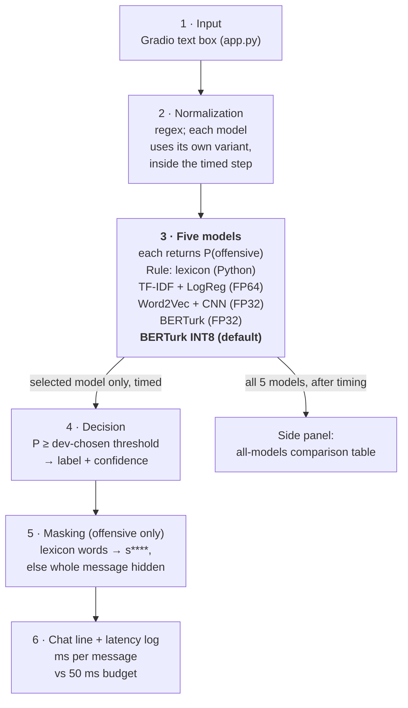

# UC4 — Real-Time Chat Moderation (Turkish)

**SWE015 Introduction to Large Language Models — Homework, Use Case 4**
Dilara Gültekin · 2309011002

An application that labels Turkish chat messages as **clean / offensive** in real time on
a CPU, masks offensive messages and logs the response time of every message
("Sohbet Kalkanı"). A four-rung model ladder is compared on the same test set and the
same CPU; the default model in the app is BERTurk quantized to INT8.

| | Link |
|---|---|
| Trained model files | https://huggingface.co/Dilara00004/uc4-turkce-sohbet-moderasyonu |
| Demo video | *(to be added)* |
| Presentation (PDF) | *(to be added)* |

---

## Quick start (running the app)

**Requirement: Python 3.12 or 3.13** (tested with 3.12.10). Python 3.14 is not
supported: `scikit-learn==1.6.1` has no 3.14 package. No GPU is needed.

**Windows (PowerShell)** — `py -3.12` is the Python launcher; if you don't have it, use the full path of Python 3.12:

```powershell
py -3.12 -m venv venv
venv\Scripts\python.exe -m pip install -r requirements.txt
venv\Scripts\python.exe app.py
```

**Linux / macOS:**

```bash
python3.12 -m venv venv
# Linux only: install the CPU build first, otherwise ~2 GB of CUDA packages are downloaded
venv/bin/python -m pip install torch==2.15.0 --index-url https://download.pytorch.org/whl/cpu
venv/bin/python -m pip install -r requirements.txt
venv/bin/python app.py
```

The app opens at `http://127.0.0.1:7860`.

**On the first start** the missing model files (~630 MB) are downloaded automatically from
the Hugging Face repository above, from a pinned commit. The SHA-256 checksum of every
downloaded file is compared with `models_manifest.json` in this repository; a file that does
not match is deleted and that model is not loaded. Later starts need no internet. You can
also download them beforehand:

```bash
venv/bin/python -m src.model_store download     # Windows: venv\Scripts\python.exe -m src.model_store download
venv/bin/python -m src.model_store verify       # checks the local files against their SHA-256
```

Tests (no network access; all tests run once the models are downloaded):

```bash
venv/bin/python -m pytest tests -q
```

> Note: on Windows the `activate` script can silently fail because of a PowerShell
> setting; `python` then calls a different installation. That is why the commands use the
> environment's `python.exe` directly.

## The application

- Chat window on the left: every message is shown with a **clean / offensive** label
  (in Turkish: *temiz / saldırgan*) and a confidence score.
- Offensive messages are masked: words found in the lexicon are starred as `s****`;
  if no lexicon word is found, the whole message is hidden.
- Side panel on the right: model selection, the last message's result in **all five
  models** side by side, a latency log of every message (budget ≤ 50 ms) and a status
  section showing that the INT8 model is loaded.

## Architecture



- Everything runs on the CPU (measurements: Intel i7-13650HX, Windows 11, 4 threads, GPU hidden).
- BERTurk keeps upper/lower case but lowercases words written ENTIRELY IN CAPITALS; the
  other models use text lowercased with Turkish rules.
- Model files are downloaded from Hugging Face Hub at start-up and verified (`src/model_store.py`).

## Model ladder and technique map

| Area | Technique | Component in the app | Code |
|---|---|---|---|
| B | Regular expressions, text normalization | every message is cleaned before every model | `src/lexicon/normalizer.py` |
| B | Minimum edit distance | lexicon matcher: rule model and masking | `src/lexicon/matcher.py`, `build_lexicon.py` |
| B | tf-idf | word 1–2 + character 2–5 n-grams → logistic regression | `src/02_classical_baseline.py` |
| B · A | word2vec (skip-gram, trained by us) | 200-dimensional vectors trained on train only | `src/03_word2vec_nn.py` |
| A | 1D CNN, dropout, backpropagation | TextCNN on the Word2Vec vectors | `src/nn_models.py` |
| C | BERTurk fine-tuning, WordPiece | `dbmdz/bert-base-turkish-cased` + classification head | `src/04_bertturk_finetune.py` |
| D | Dynamic INT8 quantization | the app's default model | `src/05_quantization.py` |
| D | Size, latency and accuracy benchmark | results table: same test set, CPU | `src/06_benchmark.py` |

A = neural networks · B = classical NLP · C = Transformers · D = efficient models

## Evaluation protocol

- **train** (30,000): model training, Word2Vec, lexicon statistics
- **dev** (1,756): selection of hyperparameters, architecture, lexicon configuration and decision threshold
- **test** (3,528, the official OffensEval-TR test set): only inside `06_benchmark.py`, once
- Metric: macro-F1 (the classes are imbalanced, ~20% offensive)
- Latency: 200 different test messages, one at a time (batch = 1), end to end (normalization +
  tokenization + model), after 10 warm-up runs; mean and p95; CPU, 4 threads
- Latency budget: **p95 ≤ 50 ms per message** (CPU), set before measuring

## Results

Official test set (3,528 messages). Hardware: Intel Core i7-13650HX, Windows 11,
PyTorch 2.15 (CPU), 4 threads, GPU hidden. Source: `results/results_table.md`,
details in `results/results.json`, every message's prediction in `results/test_predictions.csv`.

| Model | Test macro-F1 | Size (MB) | Latency mean (ms) | Latency p95 (ms) | Budget (p95 ≤ 50 ms) |
|---|---|---|---|---|---|
| Rule: lexicon + edit distance | 0.7131 | 0.2 | 0.14 | 0.35 | ✓ |
| TF-IDF + Logistic Regression | 0.7697 | 6.9 | 1.21 | 2.18 | ✓ |
| Word2Vec + Neural Network (1D CNN) | 0.7147 | 25.8 | 0.37 | 0.61 | ✓ |
| BERTurk (FP32) | 0.8114 | 442.5 | 22.15 | 40.11 | ✓ |
| **BERTurk (INT8 quantized) — in the app** | **0.8177** | **186.0** | **16.40** | **22.27** | ✓ |

- BERTurk beats TF-IDF in macro-F1 by 0.042 (FP32) and 0.048 (INT8).
- The INT8 model is 2.4× smaller and its p95 latency drops from 40.1 to 22.3 ms. The difference
  between FP32 and INT8 changed sign between two runs (−0.007, +0.006); it is at noise level.
- FP32 also fits the budget on this laptop; INT8 stays under half the budget and leaves headroom.
- In dynamic INT8 the activation scale also sees the padding tokens, so a message's
  probability can change with the batch size; the INT8 model is therefore evaluated one
  message at a time, as in the app (`models/bertturk_int8/meta.json` → `batch_effect_int8`).
- Failure examples: `results/failure_examples.csv`.
- The INT8 model uses a different compute engine depending on the operating system (this
  table: Windows, oneDNN). On another system the INT8 macro-F1 may differ very slightly in the last digit.

**First evaluation (v1).** While testing the app, insults written ENTIRELY IN CAPITALS
("İT HERİF") were labeled clean. Normalization was fixed to lowercase all-caps words,
BERTurk was retrained and the threshold was again chosen on dev. The results from before the
fix were not deleted: `results/eval_v1_before_allcaps_fix/`
(v1: BERTurk FP32 0.8223, INT8 0.8150). The rule, TF-IDF and CNN results are identical
in both runs.

## Full reproduction (training)

The steps of this project were run in these environments:

- **Google Colab, NVIDIA L4 GPU:** data preparation and model training
  (`01`, `02`, `03`, `04`) — `notebooks/colab_train.ipynb`.
  Package versions of the Colab environment: `results/env_colab.txt`.
- **Laptop, CPU only** (Intel i7-13650HX, Windows 11, 4 threads): lexicon building
  (`build_lexicon.py`), INT8 quantization (`05`), final test and latency measurement (`06`), the app.
  Package versions of the laptop environment: `results/env_laptop.txt`.

The GPU was used for training only. All reported latency numbers are on the CPU
(UC4 scenario: a CPU-only server).

Training uses `requirements-train.txt` (the app packages + `gensim`).
To train locally on a GPU, install PyTorch from the CUDA package first:

```bash
pip install torch==2.15.0 --index-url https://download.pytorch.org/whl/cu126
pip install -r requirements-train.txt
python -m pytest tests -q
python src/01_data_prep.py
python src/lexicon/build_lexicon.py
python src/02_classical_baseline.py
python src/03_word2vec_nn.py
python src/04_bertturk_finetune.py
python src/05_quantization.py
python src/06_benchmark.py
python app.py
```

Because `06_benchmark.py` also measures latency on 200 messages for every model, it can take
a long time on slow computers.

To retrain the models and upload them to the Hub (after `hf auth login`):

```bash
python -m src.model_store manifest --repo-id USER/REPO
hf upload USER/REPO models . --exclude ".gitkeep" --exclude ".cache/*"
python -m src.model_store pin
```

## Data and sources

- **OffensEval-TR 2020** — Çöltekin, Ç. (2020). *A Corpus of Turkish Offensive Language on
  Social Media.* LREC 2020, 6174–6184. License: CC-BY-2.0.
  Version used: [`stefan-it/offenseval2020_tr`](https://huggingface.co/datasets/stefan-it/offenseval2020_tr)
  (commit `f34679c`), which splits the official training set into 30,000 train + 1,756 dev; the test set is unchanged.
- **Lexicon seed list** — [`ooguz/turkce-kufur-karaliste`](https://github.com/ooguz/turkce-kufur-karaliste)
  (commit `56962ae`), CC-BY-SA-4.0. The list is not used as is; every entry is audited
  on the training data (`results/lexicon/external_audit.csv`). 39 words that are not offensive
  on their own were removed by hand (`src/lexicon/manual_exclusions.txt`, with reasons). The derived
  lexicon (`src/lexicon/offensive_words.txt`) is shared under the same license.
- **BERTurk** — `dbmdz/bert-base-turkish-cased` (MDZ Digital Library team, Bavarian State Library), MIT.

## AI usage

Claude (Anthropic) was used as a coding assistant: writing and debugging code
(data preparation, the four models, quantization, benchmark, the Gradio app), unit and
integration tests, this README and a first draft of the presentation.

All training (Google Colab) and the quantization, test and latency measurements (my own
laptop) were run by me. Every reported number comes from my own outputs in the `results/`
folder. I found the ALL-CAPS bug while testing the app by hand; I reviewed and approved
every change and chose to also report the results of the first run.
