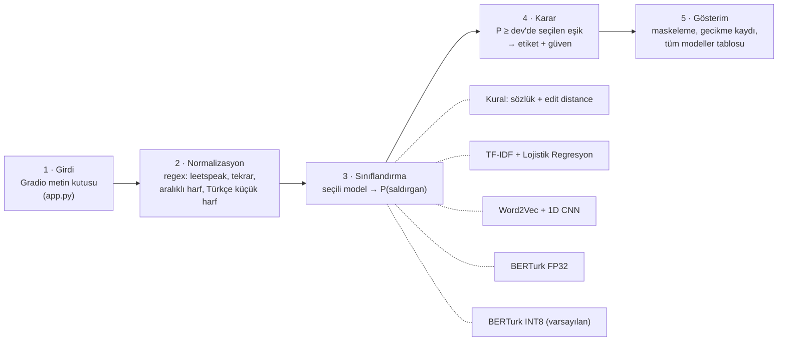

# UC4 — Real-Time Chat Moderation (Turkish)

**SWE015 Introduction to Large Language Models — Homework, Use Case 4**
Dilara Gültekin · 2309011002

Türkçe sohbet mesajlarını CPU üzerinde gerçek zamanlı olarak **temiz / saldırgan**
diye etiketleyen, saldırgan mesajları maskeleyen ve her mesajın yanıt süresini
kaydeden bir uygulama ("Sohbet Kalkanı"). Dört basamaklı model merdiveni aynı test
setinde, aynı CPU'da karşılaştırılır; uygulamada varsayılan model INT8 quantize
edilmiş BERTurk'tür.

| | Link |
|---|---|
| Eğitilmiş model dosyaları | https://huggingface.co/Dilara00004/uc4-turkce-sohbet-moderasyonu |
| Demo videosu | *(eklenecek)* |
| Sunum (PDF) | *(eklenecek)* |

---

## Hızlı başlangıç (uygulamayı çalıştırmak)

**Gereksinim: Python 3.12 veya 3.13** (3.12.10 ile test edildi). Python 3.14
desteklenmez: `scikit-learn==1.6.1`'in 3.14 paketi yoktur. GPU gerekmez.

**Windows (PowerShell)** — `py -3.12` Python başlatıcısıdır; yoksa Python 3.12'nin tam yolunu kullanın:

```powershell
py -3.12 -m venv venv
venv\Scripts\python.exe -m pip install -r requirements.txt
venv\Scripts\python.exe app.py
```

**Linux / macOS:**

```bash
python3.12 -m venv venv
# Yalnızca Linux: önce CPU sürümünü kurun, yoksa ~2 GB'lık CUDA paketleri iner
venv/bin/python -m pip install torch==2.15.0 --index-url https://download.pytorch.org/whl/cpu
venv/bin/python -m pip install -r requirements.txt
venv/bin/python app.py
```

Tarayıcıda `http://127.0.0.1:7860` açılır.

**İlk açılışta** eksik model dosyaları (~630 MB) yukarıdaki Hugging Face deposundan,
sabitlenmiş bir commit'ten otomatik indirilir. İndirilen her dosyanın SHA-256 özeti
repodaki `models_manifest.json` ile karşılaştırılır; tutmayan dosya silinir ve o model
yüklenmez. Sonraki açılışlarda internet gerekmez. İsterseniz önceden indirebilirsiniz:

```bash
venv/bin/python -m src.model_store download     # Windows: venv\Scripts\python.exe -m src.model_store download
venv/bin/python -m src.model_store verify       # yereldeki dosyaları SHA-256 ile kontrol eder
```

Testler (ağa çıkmaz; modeller indirildikten sonra bütün testler çalışır):

```bash
venv/bin/python -m pytest tests -q
```

> Not: Windows'ta `activate` betiği PowerShell ayarı yüzünden sessizce çalışmayabilir;
> o zaman `python` başka bir kurulumu çağırır. Bu yüzden komutlar ortamın
> `python.exe` dosyasını doğrudan kullanır.

## Uygulama

- Solda sohbet penceresi: her mesaj **temiz / saldırgan** etiketi ve güven puanıyla görünür.
- Saldırgan mesaj maskelenir: sözlükte bulunan kelimeler `s****` biçiminde yıldızlanır;
  sözlükte kelime yoksa mesajın tamamı gizlenir.
- Sağ panel: model seçimi, son mesajın **beş modeldeki** sonucu yan yana, her mesajın
  gecikme kaydı (bütçe ≤ 50 ms) ve INT8 modelin yüklendiğini gösteren durum bölümü.

## Mimari



- Her şey CPU'da çalışır (ölçümler: Intel i7-13650HX, Windows 11, 4 thread, GPU gizli).
- BERTurk büyük/küçük harfi korur ama TAMAMI BÜYÜK HARF kelimeleri küçültür; diğer
  modeller Türkçe kurallarıyla küçük harfe çevrilmiş metni kullanır.
- Model dosyaları açılışta Hugging Face Hub'dan indirilir ve doğrulanır (`src/model_store.py`).

## Model merdiveni ve teknik haritası

| Alan | Teknik | Uygulamadaki bileşen | Kod |
|---|---|---|---|
| B | Düzenli ifadeler, metin normalizasyonu | her mesaj her modelden önce temizlenir | `src/lexicon/normalizer.py` |
| B | Minimum edit distance | sözlük eşleştirici: kural modeli ve maskeleme | `src/lexicon/matcher.py`, `build_lexicon.py` |
| B | tf-idf | kelime 1–2 + karakter 2–5 n-gram → lojistik regresyon | `src/02_classical_baseline.py` |
| B · A | word2vec (skip-gram, kendi eğitimimiz) | yalnızca train ile eğitilen 200 boyutlu vektörler | `src/03_word2vec_nn.py` |
| A | 1D CNN, dropout, geri yayılım | Word2Vec vektörleri üzerinde TextCNN | `src/nn_models.py` |
| C | BERTurk ince ayarı, WordPiece | `dbmdz/bert-base-turkish-cased` + sınıflandırma başlığı | `src/04_bertturk_finetune.py` |
| D | Dinamik INT8 quantization | uygulamanın varsayılan modeli | `src/05_quantization.py` |
| D | Boyut, gecikme, doğruluk ölçümü | sonuç tablosu: aynı test seti, CPU | `src/06_benchmark.py` |

A = sinir ağları · B = klasik NLP · C = Transformer · D = verimli modeller

## Değerlendirme protokolü

- **train** (30 000): model eğitimi, Word2Vec, sözlük istatistikleri
- **dev** (1 756): hiperparametre, mimari, sözlük yapılandırması ve karar eşiği seçimi
- **test** (3 528, resmi OffensEval-TR test seti): yalnızca `06_benchmark.py` içinde, bir kez
- Metrik: macro-F1 (sınıflar dengesiz, ~%20 saldırgan)
- Gecikme: 200 farklı test mesajı, tek tek (batch = 1), uçtan uca (normalizasyon +
  tokenizasyon + model), 10 ısınma çalıştırması sonrası; ortalama ve p95; CPU, 4 thread
- Gecikme bütçesi: **p95 ≤ 50 ms / mesaj** (CPU), ölçümden önce belirlendi

## Sonuçlar

Resmi test seti (3 528 mesaj). Donanım: Intel Core i7-13650HX, Windows 11,
PyTorch 2.15 (CPU), 4 thread, GPU gizli. Kaynak: `results/results_table.md`,
ayrıntılar `results/results.json`, her mesajın tahmini `results/test_predictions.csv`.

| Model | Test macro-F1 | Boyut (MB) | Gecikme ort. (ms) | Gecikme p95 (ms) | Bütçe (p95 ≤ 50 ms) |
|---|---|---|---|---|---|
| Kural: sözlük + edit distance | 0.7131 | 0.2 | 0.14 | 0.35 | ✓ |
| TF-IDF + Lojistik Regresyon | 0.7697 | 6.9 | 1.21 | 2.18 | ✓ |
| Word2Vec + Sinir Ağı (1D CNN) | 0.7147 | 25.8 | 0.37 | 0.61 | ✓ |
| BERTurk (FP32) | 0.8114 | 442.5 | 22.15 | 40.11 | ✓ |
| **BERTurk (INT8 quantized) — uygulamada** | **0.8177** | **186.0** | **16.40** | **22.27** | ✓ |

- BERTurk, TF-IDF'i macro-F1'de 0.042 (FP32) ve 0.048 (INT8) geçer.
- INT8 modeli 2.4 kat küçüktür ve p95 gecikmesi 40.1 → 22.3 ms'ye düşer. FP32 ile INT8
  arasındaki fark iki çalıştırmada işaret değiştirdi (−0.007, +0.006); gürültü düzeyindedir.
- FP32 de bu dizüstünde bütçeye sığmaktadır; INT8 bütçenin yarısının altında kalarak pay bırakır.
- Dinamik INT8'de aktivasyon ölçeği dolgu (padding) tokenlarını da gördüğü için bir
  mesajın olasılığı batch boyutuna göre değişebilir; bu yüzden INT8 modeli, uygulamadaki
  gibi her mesaj tek tek değerlendirilir (`models/bertturk_int8/meta.json` → `batch_effect_int8`).
- Hata örnekleri: `results/failure_examples.csv`.
- INT8 modeli işletim sistemine göre farklı hesaplama motoru kullanır (Windows: oneDNN,
  Linux: x86). Linux'ta sıfırdan kurulumda INT8 macro-F1 0.8181 ölçüldü (Windows'ta 0.8177);
  diğer dört modelin sonuçları birebir aynıdır.

**İlk değerlendirme (v1).** Uygulamayı test ederken TAMAMI BÜYÜK HARFLE yazılmış
hakaretlerin ("İT HERİF") temiz sayıldığı görüldü. Normalizasyon, BÜYÜK HARF kelimeleri
küçültecek şekilde düzeltildi, BERTurk yeniden eğitildi ve eşik yine dev'de seçildi.
Düzeltmeden önceki sonuçlar silinmedi: `results/eval_v1_before_allcaps_fix/`
(v1: BERTurk FP32 0.8223, INT8 0.8150). Kural, TF-IDF ve CNN sonuçları iki
çalıştırmada birebir aynıdır.

## Tam yeniden üretim (eğitim)

Bu projede adımlar şu ortamlarda çalıştırılmıştır:

- **Google Colab, NVIDIA L4 GPU:** veri hazırlama ve model eğitimleri
  (`01`, `02`, `03`, `04`) — `notebooks/colab_train.ipynb`.
  Colab ortamının paket sürümleri: `results/env_colab.txt`.
- **Laptop, yalnızca CPU** (Intel i7-13650HX, Windows 11, 4 thread): sözlük oluşturma
  (`build_lexicon.py`), INT8 quantization (`05`), final test ve gecikme ölçümü (`06`), uygulama.
  Laptop ortamının paket sürümleri: `results/env_laptop.txt`.

GPU yalnızca eğitimde kullanılmıştır. Raporlanan bütün gecikme sayıları CPU'dadır
(UC4 senaryosu: yalnızca CPU olan sunucu).

Eğitim için `requirements-train.txt` kullanılır (uygulama paketleri + `gensim`).
Yerelde GPU ile eğitim için PyTorch'u önce CUDA paketinden kurun:

```bash
pip install torch==2.15.0 --index-url https://download.pytorch.org/whl/cu126
pip install -r requirements-train.txt
python -m pytest tests -q
python src/01_data_prep.py
python src/lexicon/build_lexicon.py
python src/02_classical_baseline.py
python src/03_word2vec_nn.py
python src/04_bertturk_finetune.py
python src/05_quantization.py
python src/06_benchmark.py
python app.py
```

`06_benchmark.py` her model için 200 mesajlık gecikme ölçümü de yaptığından yavaş
bilgisayarlarda uzun sürebilir (2 çekirdekli bir makinede 25 dakikayı aştı).

Modelleri yeniden eğitip Hub'a yüklemek isteyen için (`hf auth login` sonrası):

```bash
python -m src.model_store manifest --repo-id KULLANICI/DEPO
hf upload KULLANICI/DEPO models . --exclude ".gitkeep" --exclude ".cache/*"
python -m src.model_store pin
```

## Veri ve kaynaklar

- **OffensEval-TR 2020** — Çöltekin, Ç. (2020). *A Corpus of Turkish Offensive Language on
  Social Media.* LREC 2020, 6174–6184. Lisans: CC-BY-2.0.
  Kullanılan sürüm: [`stefan-it/offenseval2020_tr`](https://huggingface.co/datasets/stefan-it/offenseval2020_tr)
  (commit `f34679c`), resmi eğitim setini 30 000 train + 1 756 dev olarak böler; test seti değişmez.
- **Sözlük tohum listesi** — [`ooguz/turkce-kufur-karaliste`](https://github.com/ooguz/turkce-kufur-karaliste)
  (commit `56962ae`), CC-BY-SA-4.0. Liste doğrudan kullanılmaz; her girdi train verisinde
  denetlenir (`results/lexicon/external_audit.csv`). Tek başına saldırgan olmayan 39 kelime
  elle çıkarılmıştır (`src/lexicon/manual_exclusions.txt`, gerekçeleriyle). Türetilmiş sözlük
  (`src/lexicon/offensive_words.txt`) aynı lisansla paylaşılır.
- **BERTurk** — `dbmdz/bert-base-turkish-cased` (MDZ Digital Library team, Bavarian State Library), MIT.

## AI kullanımı

Claude (Anthropic) kodlama asistanı olarak kullanılmıştır: kod yazımı ve hata ayıklama
(veri hazırlama, dört model, quantization, benchmark, Gradio uygulaması), birim ve
entegrasyon testleri, bu README ve sunumun ilk taslağı.

Bütün eğitimler (Google Colab) ile quantization, test ve gecikme ölçümleri (kendi
bilgisayarım) tarafımdan çalıştırılmıştır. Raporlanan her sayı `results/` klasöründeki
kendi çıktılarımdan gelir. Uygulamayı elle test ederken BÜYÜK HARF hatasını buldum;
her değişikliği inceleyip onayladım ve ilk çalıştırmanın sonuçlarını da raporlamayı seçtim.
